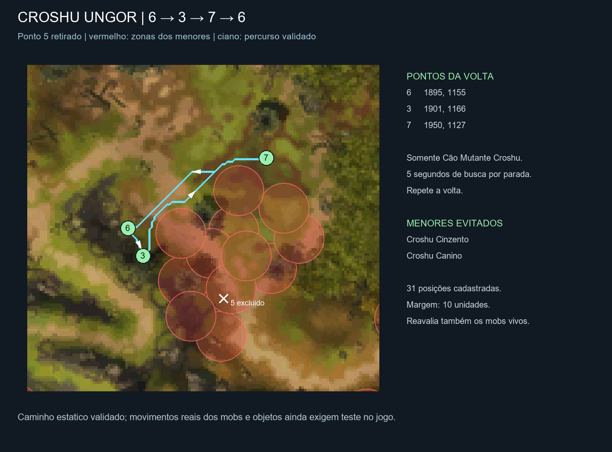

# Circuito de Croshu Mutante em Ungor, afastado dos menores

Selecione o personagem em **Básico → Cliente do Aika**. Em **Comportamento → Modo de caça**, escolha **Croshu · Ungor · 6 → 3 → 7**. Comece perto de **1895, 1155** com a caça nativa desligada e clique em **Começar**. F12 encerra o nosso motor.

A volta é **6 → 3 → 7 → 6**, repetida durante o tempo configurado para a sessão. O usuário retirou expressamente o ponto 5 após ser informado de que ele fica a aproximadamente cinco unidades de um Croshu menor cadastrado.

| Ponto | X | Y |
| --- | --- | --- |
| 6 | 1895 | 1155 |
| 3 | 1901 | 1166 |
| 7 | 1950 | 1127 |

O filtro aceita somente **Cão Mutante Croshu**, registro 1374, dentro da faixa do circuito e fora das zonas de afastamento. Não confundir com Croshu Mutante das Cinzas, de outro setor. Os outros pontos mutantes 1, 2, 4 e 5 também ficam fora da área elegível após aplicar a faixa e as exclusões.

Como a cor e o tamanho não são campos confirmados na tabela, o desvio cobre conservadoramente as duas espécies de Croshu não mutantes cadastradas na região: **Croshu Cinzento** (1206, 16 posições) e **Croshu Canino** (1207, 15 posições). Foram bloqueadas zonas de **10 unidades** ao redor dessas 31 posições, com margem adicional de meia diagonal da célula. A busca de caminho usa colisão, alturas e essas exclusões. Todos os segmentos gerados permanecem a mais de dez unidades das posições dos menores.

Na navegação, a máscara é reaplicada à grade carregada e inclui os menores vivos retornados pelo leitor de entidades. O motor também exclui alvos dentro dessas zonas. Se o novo bloqueio não permitir passagem, aguarda e recalcula, sem atravessá-lo à força. A célula já ocupada pode ser preservada apenas para permitir sua saída; colisões nativas nunca são removidas. Isso não garante evitar aggro ou contato de um mob que caminhe até o personagem entre duas leituras.

Cada parada tem cinco segundos de busca. O combate preserva o alvo até confirmar o abate ou acionar as recuperações existentes. Depois procura outro mutante elegível ou retoma o trecho. Não reinicia a volta por causa de uma luta. O seletor de cliente, atalhos, cura e buffs são preservados.

Para regenerar os caminhos e o mapa:

```powershell
python tools/validar_circuito_croshu.py --game-dir "C:\GoLevel\AikaOnline" --out huntingaitan/dados/circuito_ungor_croshu.json --mapa docs/mapeamento_croshu_ungor/circuito_croshu.png
```



Testes cobrem: exclusão do ponto 5 e das espécies menores, distância de cada segmento aos 31 pontos cadastrados, fechamento da volta, máscara de menores vivos sem apagar colisão, preservação da conta e dos atalhos, e simulação de seis abates em duas levas com uma volta entre elas. A movimentação e os encontros reais ainda precisam de validação no jogo.
